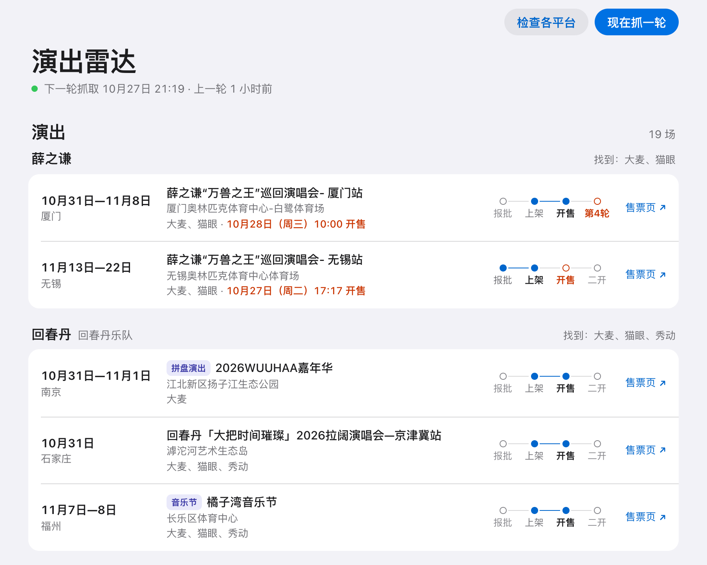

<div align="center">


# 演出雷达

关注的艺人要开演出，从报批、上架到开售、二开，阶段变了就推到你手机上。

[](LICENSE)
[](#准备)
[](package.json)

[快速开始](#快速开始) · [推送通道](#推送通道) · [常见问题](#常见问题) · [设计说明](docs/design.md)

</div>

<picture>
  <source media="(prefers-color-scheme: dark)" srcset="docs/images/web-dark.png">
  
</picture>

<p align="center"><sub>本机网页。截图里的演出取自仓库的测试样本，是 2026 年 10 月 27 日的数据。</sub></p>

同一场演出的消息散在好几处：文旅部公示审批，大麦、猫眼、秀动各自上架、公布开票时间，二开、三开也各发各的。演出雷达每天定时去这几处查，同一场的消息并在一起排成时间线，阶段变了才推送。

只看公开页面，不登录、不下单、不抢票。

## 功能

- 大麦、猫眼、秀动每天查两轮，北京时间 9 点、21 点前后各一轮。文旅部的公示每天凌晨更新，上午那轮顺带查。
- 同一场演出在文旅部和各平台的记录并在一起，排成时间线：报批、上架、待开票、开售，再到二开、三开。
- 推送和网页都写演出名，音乐节、拼盘演出会标出来，不和专场混在一起。
- 阶段变了、开售时间公布或改了才推送，没变化不打扰。开售前 30 分钟还会提醒。
- 新关注的艺人，第一轮先发汇总：各平台找到了什么，眼下有哪些演出。
- 哪个平台连续 3 轮取不到数据，会推送提醒，恢复了也会告诉你。每周一发周报，周一没收到，说明程序停了。
- 推送有总开关。暂停时照常抓取，什么都不发；恢复后马上补发还有用的消息，开售时间已经过了的不补。
- 本机网页上，每场演出都画着时间线，走到哪一步一看便知。

收到的推送长这样：

```text
薛之谦 · 无锡 · 待开票
11月13日—22日 · 无锡奥林匹克体育中心体育场
10月27日（周二）17:17 开售（大麦、猫眼）
薛之谦“万兽之王”巡回演唱会- 无锡站
已报批 → 已上架 → 待开票
```

## 只读，不抢票

- 不下单、不抢票、不提交候补，不碰支付和票档库存。
- 不登录，不用你的账号和 Cookie，不识别验证码，不换代理 IP。
- 被平台拦下就停掉这个平台，下一轮再试。

请求频率的下限写死在代码里，改配置改不掉：

- 同一平台两次请求至少隔 2 秒。
- 同一位艺人在同一平台，1 小时内不重复查，预演也算。
- 最多关注 50 位艺人，每位最多 5 个别名。
- 只访问白名单里的域名。下单、库存、登录这类接口，请求发出前就会拦下。

抢票、代抢这类改动一律不收，见[贡献约定](CONTRIBUTING.md)。

## 快速开始

### 准备

- 机器要在中国大陆的网络里：自己的电脑、NAS、国内的云服务器都行。境外服务器和 GitHub Actions 不行，原因见“长期运行”。电脑开着代理或加速器的全局模式、TUN 模式时，请求会从境外出去，先关掉。
- Node.js 要 22.13 或更高版本，不用装别的依赖。官网下载慢，可以用国内镜像 `https://registry.npmmirror.com/-/binary/node/`。
- 收推送不用另装软件。推荐邮件：用自己的邮箱发给自己，手机自带的邮件 App 就能收；QQ 邮箱的信还能在微信的“QQ邮箱提醒”里看。也可以加配 Server酱，微信扫码就能用。

### 在自己电脑上

先把仓库下载到本地：在 GitHub 页面点 Code → Download ZIP 再解压，或者用 `git clone`。下面的命令都在仓库目录里运行。

自己的电脑上只要这条命令：

```bash
node src/cli.mjs start
```

程序会一直运行，到点就抓取，同时用浏览器打开本机网页。网页上做三件事：

1. 在“艺人”里加要关注的艺人，别名用顿号隔开，比如“告五人、潘云安”。
2. 在“推送”里配好通道。推荐邮件，授权码怎么拿见下文的“邮件”。填完会发测试消息，收到就算配好了。
3. 点右上角的“现在抓一轮”。第一轮先给新关注的艺人发汇总，之后有变化才推送。

按 Ctrl+C 或关掉终端窗口，抓取和网页一起停。

### 本机网页

网页只有本机能打开：它只监听 `127.0.0.1`，别的电脑和手机都连不进来。

- 终端打印的链接里带着钥匙，别发给别人。浏览器第一次打开会记住钥匙，本次运行期间直接打开 `http://127.0.0.1:7788/` 就行。
- 每次启动都换新钥匙。网页提示“链接过期了”，就用终端里新打印的链接。怀疑链接泄露，重启程序，旧钥匙随即作废。
- 默认端口 7788，被占用就往后顺延，终端会显示实际端口。指定 `--port 8788` 就只用这个端口，被占用直接报错。加 `--no-open` 不自动打开浏览器。
- `web` 只开网页、不按时抓取，适合已经用 `daemon` 或定时任务运行的人查看状态、修改配置。这时网页顶部会写“只开了网页，不按时抓取”。
- 每场先写演出名，音乐节、拼盘演出前面挂个小标签；下面是场馆，再下面是在哪几家平台卖、什么时候开售。
- 每场演出右边有条时间线，分报批、上架、开售、二开四格。到过的点亮；开售时间已公布、还没开的标橙；空着的是还没到。鼠标停在“报批”上能看到批复日期。
- 新加的艺人要等下一轮抓取才去各平台找。等不及就点“现在抓一轮”，一般几分钟抓完，网页会自动刷新。
- 同一位艺人在同一平台 1 小时内不重复抓取，刚抓完再点“现在抓一轮”会跳过这些艺人。“检查各平台”也有间隔，同一平台 1 分钟内不重复检查。
- “推送”最上面是总开关“允许推送”。关掉就暂停推送，大标题下面那行会写“推送已暂停”。暂停期间的开售提醒、周报、平台提醒不补发。
- 推送密钥只能填，不能看，存好后只显示“已配好”。
- 网页不加载外部资源，也不记日志。

### 只用命令行

习惯命令行，或者机器没有桌面，可以分步来：

1. 关注艺人，别名用顿号隔开：

   ```bash
   node src/cli.mjs follow 告五人、潘云安
   ```

2. 检查各平台连不连得上：

   ```bash
   node src/cli.mjs check
   ```

3. 配推送。按提示选通道、填密钥，填完会发测试消息：

   ```bash
   node src/cli.mjs setup-push
   ```

4. 预演一轮，只打印要推送的内容，不真发：

   ```bash
   node src/cli.mjs run --dry-run
   ```

   预演也会真的去各平台抓取，之后 1 小时内正式运行会跳过这些艺人。下一步的 `daemon` 满 1 小时后自动补抓，那时才发汇总。不想等就跳过这步。

5. 长期运行：

   ```bash
   node src/cli.mjs daemon
   ```

艺人清单、状态库、推送密钥都放在仓库的 `.runtime/` 目录里。网页和命令行改的是同一份，可以混着用。

## 推送通道

| 通道 | 在哪收 | 费用和限制 | 密钥怎么拿 |
| --- | --- | --- | --- |
| 邮件（推荐） | 自己的邮箱；QQ 邮箱还能在微信的“QQ邮箱提醒”里收 | 免费，每轮最多一封 | 在邮箱设置里开启 SMTP 服务、拿授权码，见下文的“邮件” |
| Server酱 | 微信 | 免费版每天 5 条，只显示标题 | 微信扫码登录 `https://sct.ftqq.com/`，复制 SendKey |
| WxPusher | WxPusher 自己的 App | 免费 | 扫 `https://wxpusher.zjiecode.com/docs/spt.html` 上的二维码拿 SPT |
| Bark | iPhone | 免费 | 装 Bark App，复制首页的推送地址 |
| 企业微信 | 微信 | 免费，需要有固定公网 IP 的服务器和备案过的域名 | 见[部署说明](docs/deploy.md)“企业微信” |

- 可以同时配几个通道，每个都发，只要有通道发成功就算送达。加、删通道在网页的“推送”里，或者再运行 `setup-push`。
- 邮件和 Server酱 只收合并后的消息：同一轮要推的几条合在一起，标题写最要紧的那条，开售时间也写进标题。邮件每轮最多一封，不会塞满收件箱。其他通道照常逐条推送。
- Server酱 的开售提醒每次单独算一条。每天两轮抓取各可能占一条，再加上开售提醒，关注的艺人多了，5 条就不够用。邮件没有这个限制，两个都配上，Server酱 额度用完的那天照样能收到邮件。
- 密钥存在 `.runtime/secrets.env`，只留在你自己的机器上。

### 邮件

用自己的邮箱给自己发信。以 QQ 邮箱为例：

1. 开启 SMTP 服务。在电脑上登录 QQ 邮箱网页版，进入“设置 → 账号与安全”，找到“POP3/IMAP/SMTP/Exchange/CardDAV 服务”，点“开启”。按提示用绑定的手机发短信，再点“我已发送”。页面会给出 16 位授权码，授权码不是邮箱的登录密码。
2. 想在微信里收，先开提醒。在微信里打开“我 → 设置 → 通用（有的版本叫‘其他功能’）→ 辅助功能 → QQ邮箱提醒”，按提示开启。要不要先绑定 QQ 号，以微信的提示为准。
3. 在网页“推送”里点邮件的“配置”，填 QQ 邮箱地址和授权码，收信邮箱不填就发给自己。点“保存并测试”会发测试邮件。用命令行的话，运行 `setup-push` 选“邮件”。
4. 确认测试邮件到了：邮箱里能看到，微信的“QQ邮箱提醒”里也有。邮箱里有、微信里没有的话，用手机自带的邮件 App 收，一样及时。

授权码能收发这个邮箱里的所有邮件，只填在本机网页或 `setup-push` 里，不要给别人。

163、126 邮箱同理，在邮箱设置里开启 SMTP 服务、拿授权码。其他邮箱要自己填发信服务器，一般是 `smtp.` 加邮箱后缀，需要支持 465 端口的 SSL。

## 长期运行

每天北京时间 9:07、21:07 前后各抓一轮，每轮随机推迟 0 到 20 分钟。开售提醒每 10 分钟检查。

| 在哪运行 | 怎么运行 |
| --- | --- |
| 自己的电脑 | `node src/cli.mjs start`，带本机网页。电脑睡眠或关机时不抓取；开机自启、不让电脑睡着，见[部署说明](docs/deploy.md#自己的电脑) |
| 一直开着的 NAS | 用 Docker 跑常驻模式，不带网页，见[部署说明](docs/deploy.md#nas) |
| Linux 服务器 | 用安装脚本装成 systemd 定时器，见[部署说明](docs/deploy.md#linux-服务器) |

不支持 GitHub Actions，原因有三：

- GitHub 的条款不允许用它的机器跑与软件开发无关的任务。
- 定时任务会延迟，负载高时会被丢弃，fork 之后默认不运行。
- 机器在境外，访问国内平台没有保障。

## 命令

| 命令 | 做什么 |
| --- | --- |
| `start` | 常驻运行、按时抓取，同时打开本机网页。`--port 8788` 只用这个端口，`--no-open` 不自动打开浏览器 |
| `web` | 只开本机网页，查看状态、修改配置，不按时抓取。已经用 systemd 或 `daemon` 运行的用它 |
| `follow 名字、别名` | 关注艺人，也用来给已关注的艺人补别名 |
| `unfollow 名字` | 取消关注，这位艺人还没推出去的消息一并作废 |
| `status` | 列出每位艺人正在跟踪的演出和阶段 |
| `setup-push` | 选推送通道、填密钥，也能去掉配好的通道 |
| `test-push` | 给每个配好的通道发测试消息，暂停推送时也发 |
| `pause` | 暂停推送：照常抓取，什么都不发 |
| `resume` | 恢复推送，马上补发攒下的、还有用的消息 |
| `check` | 每个平台发一两个请求，看通不通。同一平台两次检查至少隔 1 分钟 |
| `run` | 抓一轮。`--dry-run` 只打印不推送，`--artist 名字` 只抓这位，`--force-slow` 不等 9 点、今天还没查过文旅部的艺人也查 |
| `remind` | 立即检查开售提醒 |
| `daemon` | 常驻运行，按时抓取和提醒 |

以上命令前面都要加 `node src/cli.mjs`。用安装脚本装在 Linux 服务器上的，直接写 `show-radar 命令`。

## 阶段怎么算

每轮先把各平台的记录按“艺人、城市、日期”归到具体场次，再看这场名下的全部记录判断阶段。比如：

- 这场开过票，又冒出以前没见过的将来开售时间，算二开、三开。
- 同一轮分批开售，两批相隔不到 72 小时，不算二开。
- 售罄后平台又开始卖、事先没有预告，推送“又有票了”。

完整规则见[设计说明](docs/design.md)。

## 常见问题

**“检查各平台”显示“被拦”或“连不上”。** 先看代理是否开着：代理或加速器的全局模式、TUN 模式会让请求从境外出去。关掉再试；或者把本机的局域网地址写进环境变量 `SHOW_RADAR_LOCAL_ADDRESS`，让请求绑定这块网卡直连。

macOS 先看能不能取到地址（Wi-Fi 一般是 en0，带网口的 Mac 可能是 en1，USB 网卡的编号更大）：

```bash
ipconfig getifaddr en0
```

有输出就是这块网卡的地址，没有就换 en1 再试。取到后这样启动：

```bash
SHOW_RADAR_LOCAL_ADDRESS=$(ipconfig getifaddr en0) node src/cli.mjs start
```

Windows 先用 `ipconfig` 查“IPv4 地址”，再在 PowerShell 里这样启动（地址换成你查到的）：

```powershell
$env:SHOW_RADAR_LOCAL_ADDRESS="192.168.1.23"; node src/cli.mjs start
```

每次启动都要带上这个变量，`check`、`daemon` 也一样。地址写错会报“绑不上 SHOW_RADAR_LOCAL_ADDRESS 写的地址”，变量为空会提示“SHOW_RADAR_LOCAL_ADDRESS 是空的”。

没开代理仍然被拦，说明平台不让这个 IP 访问，或者风控暂时收紧了。过几个小时再试，一直被拦就换台机器。不要缩短请求间隔，也不要用代理绕开。

**收不到推送。** 在网页“推送”里点“发一条测试”，或者运行 `test-push`，看各通道通不通。Server酱 免费版每天 5 条，用完当天就发不出去，第二天恢复。

**邮件发不出去。** 提示“登录这一步回 535”，多半是授权码填错了，或者邮箱没开 SMTP 服务。授权码不是登录密码。

**邮件到了，微信里没提醒。** 去微信的“QQ邮箱提醒”看看是否已开启，开好后再发测试。还是没有，就用手机自带的邮件 App 收。也看看邮件是不是进了垃圾箱。

**报错找不到 `node:sqlite`。** Node 版本不对：22 要 22.13 以上，23 要 23.4 以上，24 及以后都行。升级 Node 即可。

**改了艺人清单要重启吗？** 不用，每轮都会重新读清单和推送密钥。清单是运行目录里的 `artists.txt`：本机在 `.runtime/artists.txt`，服务器在 `/opt/show-radar/shared/runtime/artists.txt`。仓库里的 `config/artists.txt` 只是首次运行时复制用的底稿，改它不生效。

**刚抓完再抓，什么都没取到。** 同一位艺人 1 小时内不重复抓取，预演也算。等满 1 小时再抓；定时那轮如果一位都没取到，满 1 小时后会自动补抓。

**新关注的艺人，“报批”要第二天才有。** 文旅部的公示每天凌晨更新，程序在每天 9 点后的第一轮查。当天这轮查过之后才关注的艺人，要等第二天。等不及就运行 `node src/cli.mjs run --force-slow`。

**频率限制只防误操作。** 锁和取数记录都在运行目录里，换个运行目录、删掉 `.runtime/fetch-log.json`，限制就从头算。限制是为了不给平台添负担，请不要刻意绕开。

**怎么去掉推送通道？** 在网页“推送”里点该通道的“去掉”，或者运行 `setup-push`，选最后一项“去掉一个已经配过的通道”。

## 局限

- “报批”只覆盖涉外演出，即有港澳台或外国演员参演的场次。内地艺人的演出多由区县审批，不公示，时间线上这一格常常空着。
- 每天只抓两轮，公告后不到半天就开售的二开会错过，只能事后知道。
- 平台改了接口或签名，对应的数据源会停，推送会提醒，要等代码更新后恢复。
- 只在家用宽带上实测过。平台可能对云服务器的机房 IP 区别对待，装好后先跑 `check`。
- 不支持只在 App 和小程序里卖票的平台，比如纷玩岛。

## 免责声明

- 本项目仅供个人学习和自用，不得用于商业用途，不得改造成抢票、代抢、倒票工具。
- 本项目与大麦、猫眼、秀动、文化和旅游部均无关联，演出信息以各平台和官方公示为准。
- 使用前请阅读各平台的用户协议，使用本项目产生的后果由使用者自行承担。
- 本项目不接受赞助和捐赠。
- 平台方或文旅部认为本项目有不妥之处，请提 issue，我会尽快处理。

## 许可

[MIT](LICENSE)
